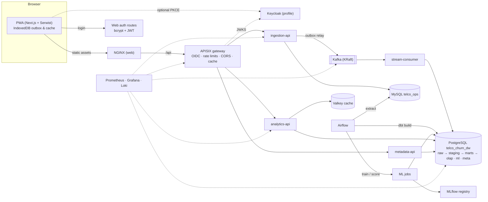

<p align="center">
  
</p>

<p align="center">
  <b>Offline-first churn analytics on a PostgreSQL star-schema data warehouse.</b><br>
  
  
  
  
  
  
  
  
  
  
</p>

# Telco Churn Analytics Platform

An offline-capable Progressive Web App on top of a PostgreSQL star-schema data warehouse for telecom customer-churn analysis: data entry and CSV batches that work offline, validated ingestion through Kafka, dbt transformations orchestrated by Airflow, OLAP analysis (roll-up, drill-down, slice, dice, pivot) and churn prediction with scikit-learn and MLflow.

It extends the academic project *Development of a Data Warehouse and Application of Data Mining Techniques for Customer Churn Analysis in the Telecommunications Sector*. The original `telco_churn_dw` star schema ships unchanged inside the warehouse image as the `legacy` schema.

Every component is free and open source (see [docs/licences.md](docs/licences.md)).

## Architecture



| Layer | Path | Technology |
|---|---|---|
| PWA | `apps/web` | Next.js 15, React 19, TypeScript strict, Serwist, Dexie, ECharts, TanStack Table, jose (JWT sessions), oidc-client-ts |
| APIs | `services/*_api` | FastAPI, Pydantic v2, SQLAlchemy 2 + Alembic (MySQL), psycopg 3 (PostgreSQL) |
| Stream consumer | `services/stream_consumer` | aiokafka, idempotent upsert on `event_id` |
| Shared contracts | `contracts/`, `libs/common_py` | JSON Schema 2020-12 used by browser, APIs and consumer |
| Transformations | `transform/dbt_telco` | dbt Core 1.12 + dbt-postgres (staging, intermediate, SCD2 snapshot, marts, OLAP MVs, ML features) |
| Orchestration | `orchestration/airflow` | Airflow 3.3 (LocalExecutor dev, CeleryExecutor prod), isolated venvs for dbt / ML / ETL |
| ML | `ml/` | scikit-learn, MLflow 3 tracking + registry (aliases `champion`, `challenger`) |
| Warehouse | `infra/db/postgres` | PostgreSQL 18, least-privilege roles, packaged as its own image |
| Gateway / identity | `infra/apisix`, `infra/keycloak` | APISIX 3.19 standalone YAML; built-in bcrypt + JWT login, Keycloak 26 realm `telco` as an optional profile |
| Observability | `infra/observability` | Prometheus, Grafana OSS, Loki, Alloy |

## Tech stack

| Area | Tools |
|---|---|
| Frontend | Next.js 15, React 19, TypeScript, Serwist (service worker), Dexie (IndexedDB outbox), ECharts, TanStack Table |
| Backend | Python, FastAPI, Pydantic v2, SQLAlchemy 2, Alembic, psycopg 3, aiokafka |
| Data | PostgreSQL 18 (star schema, OLAP materialised views), MySQL 8.4 (operational source), Valkey (cache) |
| Pipelines | Apache Kafka (KRaft), dbt Core, Apache Airflow |
| Machine learning | scikit-learn, MLflow tracking and registry |
| Edge and security | Apache APISIX, NGINX, JWT (jose), optional Keycloak |
| Observability | Prometheus, Grafana, Loki, Alloy |
| Tooling | Docker Compose, Make, pytest, Playwright, GitHub Actions |

## Quick start

Needs Docker with Compose v2.24+ and about **8 GB of memory for Docker** for the whole stack (4 GB is enough for `make up-core`).

```bash
make up          # creates .env with random secrets, builds, starts everything, runs the first pipeline
```

`make up` prints the URLs. Sign in to the PWA at http://localhost:3000 with one of the demo users — `admin`, `steward`, `entry`, `analyst`, `viewer` — using the `DEMO_USER_PASSWORD` from `.env`.

What happens on first start:

1. The warehouse image creates schemas and roles, restores the legacy star schema and lands the CSV in `raw`.
2. `dbt-bootstrap` builds staging → marts → OLAP, runs 58 data tests and reconciles against the baseline counts.
3. `airflow-bootstrap` seeds MySQL from the CSV, trains the first model (promoted to `champion` in MLflow), runs `ops_to_dw_daily`, which triggers `ml_score_daily`.

Other entry points:

| Command | What it does |
|---|---|
| `make up-core` | Databases, Kafka, Keycloak, gateway, APIs and PWA only |
| `make dw-up` | Only the packaged warehouse (PostgreSQL + dbt), project `telco-dw` |
| `make dw-package` | Exports the warehouse images and compose file to `dist/telco-churn-dw-<date>.tar` |
| `make dw-backup` / `make dw-restore FILE=…` | Logical backup / transactional restore |
| `make train` | One-off training + scoring outside Airflow |
| `make test` | Python and frontend unit tests |
| `make test-dbt` | dbt build + strict reconciliation against the baseline |
| `make e2e` | Playwright tests (needs the stack running) |
| `make prod-up` | Production overlay: TLS edge, 3 Kafka brokers, Celery workers, resource limits |

## Verified results

| Check | Result |
|---|---|
| Warehouse counts after first run | dim_customer 7,043 · dim_contract 6 · dim_service 322 · dim_payment 4 · dim_churn 2 · fact 7,043 · churn No/Yes 5,174/1,869 |
| dbt | 78 nodes, 58 data tests, 0 invalid dimension links; second (incremental + snapshot) run also passes |
| OLAP acceptance | Month-to-month 1,655/3,875 (42.71%) · One year 166/1,473 (11.27%) · Two year 48/1,695 (2.83%) · Tenure 0–12 1,037/2,186 (47.44%) · Electronic check 1,071/2,365 (45.29%) |
| Gateway | No token or forged token → 401 at APISIX; wrong role → 403 from the service |
| Ingestion | Partial batches report per-row errors; resending an Idempotency-Key returns the original result; records reach `raw` via Kafka and the star schema on the next dbt run |
| ML champion | RandomForest, F1 0.636, ROC-AUC 0.847 on the hold-out set (baseline best F1 0.630) |

Details: [docs/ml-report.md](docs/ml-report.md).

## Documentation

- [docs/architecture.md](docs/architecture.md) — components, data flow, offline sync and auth sequences
- [docs/data-model.md](docs/data-model.md) — MySQL and star-schema ERDs, roles
- [docs/api.md](docs/api.md) — endpoints and OpenAPI links
- [docs/olap-guide.md](docs/olap-guide.md) — example request for each OLAP operation
- [docs/ml-report.md](docs/ml-report.md) — method, metrics vs baseline, fairness, limitations
- [docs/runbook.md](docs/runbook.md) — backups, restore, rotating secrets, reprocessing the DLQ
- [docs/licences.md](docs/licences.md) — every dependency and its licence
- [docs/privacy.md](docs/privacy.md) — personal data handling for real (non-sample) data

## Troubleshooting

| Symptom | Cause and fix |
|---|---|
| A port is already in use | `scripts/generate-env.sh` moves busy ports when it creates `.env`; edit `*_PORT` in `.env` otherwise. |
| Containers exit with code 137 | Docker ran out of memory. Give Docker more memory or use `make up-core`. |
| PWA shows “Sign in to continue” after every reload | Tokens are memory-only by design; the Keycloak session restores them silently. Check that `PUBLIC_KEYCLOAK_URL` in `.env` is reachable from the browser. |
| 401 from every API call | The token issuer must equal `PUBLIC_KEYCLOAK_URL/realms/telco`. If you changed the Keycloak port, recreate `keycloak`, `apisix` and the APIs. |
| Predictions page says no model is available | Training has not finished. Check the `ml_train_weekly` DAG in Airflow, or run `make train`. |
| dbt fails with “permission denied to create temporary tables” | The warehouse volume predates the current image. Run `GRANT TEMPORARY ON DATABASE telco_churn_dw TO dw_owner;` as the superuser, or recreate the volume. |
| Batches stay “Waiting” in the PWA | You are offline or signed out. Sign in and press **Sync now** on the Sync page. |
