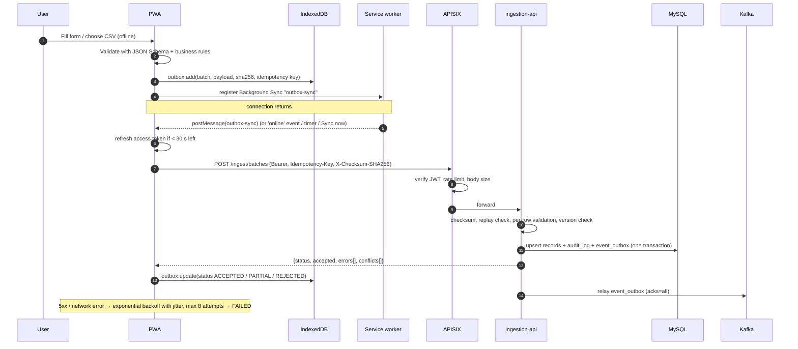

# Architecture

## Components

| Service | Responsibility | Talks to |
|---|---|---|
| `web` | NGINX serving the static PWA, strict CSP, `/api` reverse proxy to the gateway, renders `/config.json` | apisix |
| `apisix` | OIDC bearer-token validation (Keycloak JWKS), rate limits, CORS, body-size limits, GET cache for analytics, request IDs, security headers, Prometheus metrics | keycloak, APIs |
| `keycloak` | Realm `telco`, roles `admin`, `data_steward`, `data_entry`, `analyst`, `viewer`; public PWA client with PKCE | platform-db |
| `ingestion-api` | Customer/subscription CRUD, idempotent batch validation, CSV chunking, transactional outbox → Kafka | mysql, kafka |
| `stream-consumer` | Consumes `ingest.*.v1` and `ingest.dlq.v1` into `raw.ingest_events` / `raw.ingest_dlq` | kafka, dw-postgres |
| `metadata-api` | Dataset registry, data dictionary (editable), dbt lineage, data-quality runs, dimension members, pipeline status | dw-postgres, Airflow API |
| `analytics-api` | OLAP queries, KPIs, predictions, ad-hoc scoring, model registry view | dw-postgres (read-only role), valkey, MLflow, kafka |
| `dw-postgres` | The packaged warehouse (`telco/dw-postgres`) | — |
| `mysql` | Operational store `telco_ops` (3NF, binlog ROW for future CDC) | — |
| `kafka` | KRaft cluster; topics `ingest.customers.v1`, `ingest.subscriptions.v1`, `ingest.dlq.v1`, `dw.events.v1` | — |
| `airflow-*` | DAGs `seed_initial_csv`, `ops_to_dw_daily`, `ml_train_weekly`, `ml_score_daily` | mysql, dw-postgres, kafka, mlflow |
| `mlflow` | Tracking server and model registry | platform-db |
| `dbt-bootstrap` | One-shot dbt build at start-up so the warehouse is usable before Airflow runs | dw-postgres |
| observability | Prometheus (+ exporters, alert rules), Grafana dashboards, Loki + Alloy logs | everything |

## Data flow

1. The PWA validates each record against `contracts/telco-record.v1.schema.json` plus the shared business rules, and stores batches of ≤ 500 records in the IndexedDB `outbox` with a SHA-256 checksum of the exact payload.
2. When online, the sync engine posts each batch to `POST /api/v1/ingest/batches` with `Idempotency-Key` and `X-Checksum-SHA256`.
3. ingestion-api verifies the checksum, replays the stored result for a known key, validates every row, applies accepted rows to MySQL with optimistic locking (`version`), and in the **same transaction** writes the Kafka messages to `event_outbox` (rejected rows go to the DLQ topic). A relay thread publishes the outbox with `acks=all` and idempotence enabled.
4. stream-consumer lands events in `raw.ingest_events` (upsert on `event_id`) and DLQ messages in `raw.ingest_dlq`, committing offsets only after the database commit.
5. `ops_to_dw_daily` extracts MySQL rows changed since the stored watermark into `raw.ops_*`, runs `dbt build` (staging → intermediate → SCD2 snapshot → marts → OLAP), refreshes the materialised views concurrently, publishes test results to `meta.dq_*`, reconciles against the baseline and emits `dw.refreshed`. The emit task updates an Airflow asset, which triggers `ml_score_daily`.
6. `int_customer_current` merges the CSV seed, the operational extract and the event stream: the most recently updated version of each customer wins (ties: ops > stream > csv).
7. analytics-api serves OLAP and predictions; the PWA keeps the last results in `analytics_cache` for offline viewing.

## Offline sync



## Authentication

```mermaid
sequenceDiagram
  autonumber
  participant P as PWA
  participant KC as Keycloak
  participant GW as APISIX
  participant S as Service

  P->>KC: /auth (code_challenge S256)
  KC-->>P: redirect with code
  P->>KC: /token (code + code_verifier)
  KC-->>P: access token (5 min, aud telco-api, realm roles) + refresh token
  Note over P: tokens kept in memory only
  P->>GW: request + Bearer token
  GW->>GW: openid-connect (bearer_only, JWKS)
  alt invalid / missing token
    GW-->>P: 401
  else valid
    GW->>S: forward (X-Request-ID)
    S->>S: verify signature, issuer, audience, expiry again; role guard
    S-->>P: 200 or 403 (problem+json)
  end
```

After a page reload the PWA restores the session silently (hidden iframe to Keycloak). Offline, the last known profile is used to show cached data and queue writes; tokens are refreshed before the next sync.

## Security controls

- TLS at the NGINX edge in production (`docker-compose.prod.yml`, `infra/nginx/edge.conf.template`), HSTS everywhere.
- CSP without `unsafe-inline` for scripts (hashes are computed at build time), `frame-ancestors 'none'`, `X-Content-Type-Options`, `Referrer-Policy`, `Permissions-Policy`.
- Least-privilege database roles: `dw_owner` (dbt/Airflow), `dw_ingest` (raw events only), `dw_analytics` (read-only, 30 s statement timeout), `dw_meta`, `dw_ml` (writes predictions; updates the fact only through a `SECURITY DEFINER` function), `dw_monitor` (`pg_monitor`). MySQL: `ops_app`, `ops_extract` (read-only), `ops_monitor`.
- Parameterised SQL everywhere; OLAP dimensions and measures are whitelisted.
- Secrets only in the git-ignored `.env` (random values generated by `make env`); nothing secret is serialised into Airflow DAGs.
- Audit log of every data-entry change (`telco_ops.audit_log`) and of data-dictionary edits (`meta.dictionary_audit`).
- Containers run as non-root; API and web containers have a read-only root filesystem.
