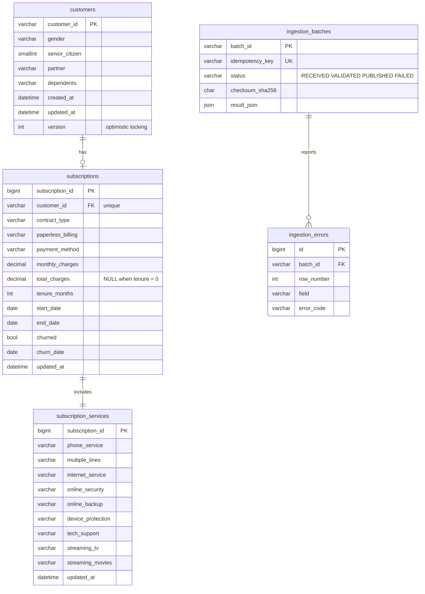

# Data model

## Operational database (MySQL `telco_ops`, 3NF)



Also: `audit_log` (before/after JSON of every change) and `event_outbox` (Kafka messages written in the same transaction as the data). Schema changes go through Alembic (`services/ingestion_api/migrations`).

## Warehouse (PostgreSQL `telco_churn_dw`)

| Schema | Owner | Contents |
|---|---|---|
| `raw` | dw_owner | `telco_csv_seed`, `ops_customers`, `ops_subscriptions`, `ops_subscription_services`, `ingest_events`, `ingest_dlq` |
| `staging` | dbt | `stg_csv_seed`, `stg_ops_records`, `stg_stream_records` (views) |
| `intermediate` | dbt | `int_customer_current` (one current record per customer) |
| `snapshots` | dbt | `snap_customer` (SCD2 history) |
| `marts` | dbt | star schema below + `fact_customer_churn_history` |
| `olap` | dbt | `churn_flat` (table), `mv_churn_by_contract_payment`, `mv_churn_by_tenure_band`, `mv_churn_cube` (materialised views) |
| `ml` | dw_owner / dbt | `ml_features`, `model_runs`, `predictions`, `current_predictions`, `drift_metrics`, `fairness_metrics` |
| `meta` | dw_owner | `datasets`, `data_dictionary`, `dictionary_audit`, `dq_runs`, `dq_results`, `pipeline_watermarks` |
| `legacy` | postgres | the original `telco_churn_dw` star schema, read-only |

### Star schema

Grain of `fact_customer_churn`: one row per current customer subscription for the load date. `fact_customer_churn_history` keeps one row per customer per load date with natural values.

```mermaid
erDiagram
  fact_customer_churn }o--|| dim_customer : customer_key
  fact_customer_churn }o--|| dim_contract : contract_key
  fact_customer_churn }o--|| dim_service : service_key
  fact_customer_churn }o--|| dim_payment : payment_key
  fact_customer_churn }o--|| dim_churn : churn_key
  fact_customer_churn }o--|| dim_date : date_key
  fact_customer_churn }o--|| dim_tenure_band : tenure_band_key
  fact_customer_churn {
    bigint customer_key FK
    int contract_key FK
    int service_key FK
    int payment_key FK
    int churn_key FK
    int date_key FK "BRIN index"
    int tenure_band_key FK
    int tenure_months
    numeric monthly_charges
    numeric total_charges
    numeric churn_probability "from champion model"
    int customer_count "always 1"
  }
  dim_customer {
    bigint customer_key PK
    varchar customer_id "natural key"
    varchar gender
    smallint senior_citizen
    varchar partner
    varchar dependents
    timestamptz valid_from
    timestamptz valid_to
    bool is_current "SCD Type 2"
  }
  dim_contract { int contract_key PK
    varchar contract_type
    varchar paperless_billing }
  dim_service { int service_key PK
    varchar phone_service
    varchar internet_service
    varchar "6 add-ons + multiple_lines" }
  dim_payment { int payment_key PK
    varchar payment_method
    bool is_automatic }
  dim_churn { int churn_key PK
    smallint churn_flag
    varchar churn_label }
  dim_date { int date_key PK "YYYYMMDD"
    date date
    smallint month
    smallint quarter
    smallint year
    bool is_weekend }
  dim_tenure_band { int tenure_band_key PK
    varchar band_label "0-12 13-24 25-48 49-72"
    int min_months
    int max_months }
```

Foreign keys from the fact to every dimension and indexes on every fact key are added by dbt post-hooks; `date_key` has a BRIN index.

### Data tests (dbt)

`unique` + `not_null` on every surrogate key, `relationships` from the fact to all seven dimensions, `accepted_values` for contract type, payment method, internet service and churn flag, plus singular tests: fact rows = current customers, churn Yes + No = total, no invalid dimension links, exactly one current row per customer, cube grand total = fact rows. `scripts/reconcile.py` compares counts and OLAP figures with `scripts/baseline.json`.
